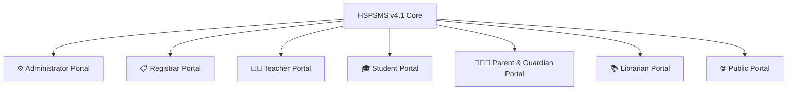

# High School & Preparatory School Management System (HSPSMS v4.1)

[](https://www.typescriptlang.org/)
[](https://nodejs.org/)
[](https://expressjs.com/)
[](https://react.dev/)
[](https://vitejs.dev/)
[](https://www.mysql.com/)
[](#)

A comprehensive, enterprise-grade school enterprise resource planning (ERP) system tailored for **Ketema Nigus Secondary & Preparatory School** (Addis Ababa, Ethiopia). Built in strict conformance with the Ethiopian National General Secondary (Grades 9–10) and Preparatory Streams (Grades 11–12: Natural Science & Social Science) curriculum.

---

## 🌟 Key Highlights

- **Zero-ORM Raw SQL Engine:** Built with raw parameterized SQL via `mysql2/promise` with connection pooling, ACID transactions, and zero ORM overhead for maximum execution speed, zero query bloat, and native support for MySQL 8 virtual generated columns.
- **Strict Role-Based Access Control (RBAC):** Seven isolated stakeholder roles (Administrator, Registrar, Teacher, Student, Parent/Guardian, Librarian, Public) with 43 granular permission flags and record-level authorization.
- **Enterprise Parent & Guardian Portal:** Two-level contextual navigation system separating family-wide management (Level 1) from isolated, child-specific workspaces (Level 2) with zero cross-child data leakage and anti-enumeration security.
- **Ethiopian Curriculum Stream Engine:** Dynamic handling of Grade 9–10 common foundational curriculum and Grade 11–12 preparatory stream allocations (*Natural Science* vs. *Social Science*) with automated continuous assessment weighting, GPA calculation, section ranking, and semester report card generation.
- **Disaster Recovery & Auditability:** Built-in cryptographic database backup snapshots, point-in-time recovery verification, recycle bin soft-delete management, and immutable append-only audit logging.
- **Real-Time Communication Hub:** Triple-stream communication platform supporting targeted administrative circulars, two-way teacher-parent messaging, and scheduled conference appointments.

---

## 🇪🇹 Ethiopian Educational System Alignment

HSPSMS v4.1 is purpose-engineered for secondary and preparatory institutions in Ethiopia, adhering to the Ministry of Education standards:

- **General Secondary (Grades 9 & 10):** Common core subjects including English, Amharic, Mathematics, Physics, Chemistry, Biology, Geography, History, Civics & Ethical Education, Information Technology, and Health & Physical Education (HPE).
- **Preparatory Streams (Grades 11 & 12):**
  - **Natural Science Stream:** Advanced Mathematics, Physics, Chemistry, Biology, Technical Drawing / ICT, English, Civics.
  - **Social Science Stream:** Mathematics for Social Science, Geography, History, Economics, General Business, English, Civics.
- **Assessment Structure:** Continuous Assessment (CA) models combining class tests, midterms, lab practicals, assignments, and semester final exams (100% composite) with automated letter grade conversion (A+ through F) and conduct assessment.

---

## 🏛️ Stakeholder Portals & Modules



### 1. 👨‍👧‍👦 Parent & Guardian Portal
- **Level 1 (Family Dashboard):** High-level family overview, linked wards directory, family-wide announcements, official registrar requests, tuition invoice summaries, and guardian account security.
- **Level 2 (Contextual Child Workspace):** Dedicated contextual sub-sidebar per verified child featuring:
  - *Child Overview:* Attendance rate, GPA, enrolled subjects count, upcoming test alerts.
  - *Academic Progress:* Filterable Continuous Assessment (CA) scores, letter grades (A+ to D), and teacher remarks.
  - *Attendance & Punctuality:* Session-by-session records (Present, Absent, Late, Excused) certified by instructors.
  - *Subjects & Learning:* Coursework catalog with assigned faculty contact details and learning material attachments.
  - *Schedule & Timetable:* Weekly period schedule grouped from Monday to Friday.
  - *Assignments & Examinations:* Upcoming assessment schedule and past evaluation breakdown.
  - *Report Cards & Documents:* Official registrar-stamped semester report cards with one-click PDF generation.
  - *Enrollment History:* Multi-year academic progression history.
- **Communication & Conference Scheduler:** Direct messages from instructors and dynamic parent-teacher conference appointment booking.

### 2. 👨‍🏫 Teacher Portal
- **Academic Dashboard & Daily Scratchpad:** Daily timetable, period attendance shortcuts, and persistent local notes scratchpad.
- **Continuous Assessment (CA) Gradebook:** Mark entry, weight calculation, assessment creation, and mark correction request workflow.
- **Attendance Management:** Homeroom and subject session attendance taking with anomaly detection.
- **Curriculum & Materials:** Uploading learning resources and assignments scoped by section.
- **Welfare & Communication:** Student behavior logs and direct guardian communications.

### 3. 🎓 Student Portal
- **Daily Timetable & Attendance Analytics:** Weekly schedule and personal attendance trend tracking.
- **Assessment Center:** Homework assignments, deadline countdowns, document submissions, and evaluated feedback.
- **Published Results & Report Cards:** Term GPA, section rank, and official report card download.

### 4. 📋 Registrar Portal
- **Student Admissions & Profile Lifecycle:** National ID/Kebele data, photo attachments, and medical alerts.
- **Guardian Legal Linking:** Document verification and granular capability assignment (`can_view_results`, `can_view_attendance`, `can_view_fees`).
- **Stream Allocation & Transfers:** Managing Grade 11–12 Natural Science vs Social Science placements.
- **Official Requests Processing:** Fulfilling transcript and bonafide certification requests.

### 5. ⚙️ Administrator Portal
- **Academic Structure:** Academic years, terms, grades, sections, classrooms, and subject allocations.
- **System Settings & RBAC:** Role and permission management, security policies, and session controls.
- **Disaster Recovery & Backups:** Scheduled and on-demand database snapshots, cryptographic integrity checks, and disk retention management.
- **Audit Trails & Recycle Bin:** Immutable logging of user activity and soft-delete recovery.

### 6. 📚 Librarian Portal
- Book cataloging, physical barcode checkout/checkin, loan renewals, overdue tracking, and fine management.

---

## 🛠️ Technology Stack

| Layer | Technology | Description |
| :--- | :--- | :--- |
| **Frontend** | React 19, TypeScript, Vite | Single Page Application with custom responsive design tokens |
| **Backend** | Express 5, Node.js 20+, TypeScript | Layered Controller-Service-Repository REST API |
| **Database** | MySQL 8.0+ (InnoDB) | `utf8mb4_0900_ai_ci`, virtual generated columns, row locks |
| **Database Driver** | `mysql2/promise` | Connection pooling with ACID transaction support |
| **Authentication** | JWT & HttpOnly Session Cookies | Rotating session cookies (`SameSite=Lax`), Bcrypt password hashing |
| **Security** | Helmet, CORS, Express-Rate-Limit | Strict request throttling and correlation request IDs (`X-Request-Id`) |

---

## 🔒 Security & Architectural Invariants

1. **Zero-ORM Invariant:** High-performance, maintainable data layer using 100% pure parameterized SQL statements. No ORM abstraction leaks, uncontrolled N+1 queries, or hidden join bloat.
2. **Anti-Enumeration & Scoped Access:** Endpoints accessing student or family data rigorously enforce verified parent-student relationships via active legal linking tables (`student_guardians`), returning uniform `404 Not Found` for nonexistent or unauthorized records to prevent user enumeration.
3. **Audit Trail Immutability:** Sensitive operational changes (admissions, grade modifications, fee receipts, database backups) write structured records to `audit_logs` capturing client IP, user agent, actor details, old values, and new values.
4. **Session Protection:** Authentication is secured via HttpOnly JWT session cookies with `SameSite=Lax` protection, preventing client-side script token theft (XSS/CSRF).
5. **Fail-Safe Disaster Recovery:** Automated and manual MySQL dump routines compute SHA-256 checksums, verify file integrity, track disk retention policies, and synchronize state with the database catalogue.

---

## 📡 REST API Route Directory

All REST API endpoints are versioned under `/api/v1/`:

| Route Prefix | Domain / Responsibilities | Primary Consumers |
| :--- | :--- | :--- |
| `/api/v1/auth` | User login, logout, password resets, session refresh, and CSRF tokens | All Portals |
| `/api/v1/admin` | Academic years, terms, user management, RBAC, backups, and audit logs | Administrator |
| `/api/v1/registrar`| Student enrollment, guardian linking, transfers, transcript requests | Registrar |
| `/api/v1/teacher` | Gradebook entry, section attendance, homework assignments, student notes | Teacher |
| `/api/v1/student` | Timetable viewing, homework submission, published term report cards | Student |
| `/api/v1/parent` | Multi-child dashboard, child progress, attendance, circulars, conferences | Parent / Guardian |
| `/api/v1/library` | Books inventory, borrowing transactions, returns, and overdue fines | Librarian |
| `/api/v1/health` | Service health checks, uptime status, and database pool connectivity | Infrastructure |

---

## 📂 Project Directory Structure

```
School Management ERP System/
├── backend/                       # REST API Backend
│   ├── src/
│   │   ├── config/                # Database pool & environment configs
│   │   ├── middleware/            # Auth, RBAC, error handlers, rate limiting
│   │   ├── modules/               # Domain feature modules (admin, auth, parent, etc.)
│   │   ├── types/                 # Shared TypeScript interfaces
│   │   └── utils/                 # PDF generators, helpers, security utilities
│   ├── test/                      # Automated acceptance & E2E verification test suites
│   ├── scripts/                   # DB migration runners and seeders
│   └── package.json
│
├── frontend/                      # React SPA Frontend
│   ├── src/
│   │   ├── api/                   # Strongly-typed API client (client.ts)
│   │   ├── components/            # Portals (Parent, Student, Teacher, Admin, Registrar)
│   │   │   ├── parent/            # Parent portal sub-components (Directory, Workspace, etc.)
│   │   │   ├── student/           # Student portal views
│   │   │   └── teacher/           # Teacher portal views
│   │   └── App.tsx                # Main portal router and shell layout
│   └── vite.config.ts
│
├── sql/                           # Database Schema & Migrations
│   ├── 01_schema.sql - 05_grants  # Core baseline schema, routines, seeds, and grants
│   └── migrations/                # Versioned SQL migrations (06 through 20)
│
├── MASTER_IMPLEMENTATION_PROMPT.md# Full architecture & domain specifications
└── README.md                      # Project documentation
```

---

## 🚀 Quick Start Guide

### Prerequisites
- **Node.js:** v20.x or higher
- **npm:** v10.x or higher
- **MySQL Server:** v8.0 or higher running on port `3306`

### 1. Database Setup
Ensure MySQL is running, then create the database and run the schema scripts:

```bash
# In your MySQL client:
CREATE DATABASE school_erp CHARACTER SET utf8mb4 COLLATE utf8mb4_unicode_ci;
```

Execute the base scripts in order:
```bash
mysql -u root -p school_erp < sql/01_schema.sql
mysql -u root -p school_erp < sql/02_routines.sql
mysql -u root -p school_erp < sql/03_seed.sql
mysql -u root -p school_erp < sql/04_sample_data.sql
```

Apply database migrations:
```powershell
cd backend
npx tsx scripts/run_migration.ts ../sql/migrations/20_parent_portal.sql
```

### 2. Backend Setup
```powershell
cd backend
npm install
Copy-Item .env.example .env
```

Configure `backend/.env` with your MySQL credentials:
```dotenv
PORT=5000
NODE_ENV=development
MYSQL_SERVER=localhost
MYSQL_PORT=3306
MYSQL_USER=root
MYSQL_PASSWORD=your_password
MYSQL_DB=school_erp
JWT_SECRET=your_super_secret_jwt_key_here
CORS_ORIGINS=http://localhost:5173,http://127.0.0.1:5173
```

### 3. Frontend Setup
```powershell
cd ../frontend
npm install
```

### 4. Running the Application
From the root directory, launch both frontend and backend concurrently:
```powershell
npm run dev
```

- **Frontend Application:** [http://localhost:5173](http://localhost:5173)
- **Backend API Base:** [http://localhost:5000/api/v1](http://localhost:5000/api/v1)
- **Health Check Endpoint:** [http://localhost:5000/api/v1/health](http://localhost:5000/api/v1/health)

---

## 👥 Default QA Evaluation Accounts

For testing all 7 stakeholder experiences:

| Role | Username | Password | Key Capabilities |
| :--- | :--- | :--- | :--- |
| **Administrator** | `admin` | `Admin#2026!` | Full system settings, backups, academic lifecycle |
| **Registrar** | `registrar` | `Registrar#2026!` | Admissions, guardian verification, stream allocations |
| **Teacher** | `teacher.abebe` | `Teacher#2026!` | Gradebook scoring, attendance taking, communications |
| **Parent / Guardian** | `parent.kassa` | `QaTest#2026` | Two-level navigation, multi-child workspace, conferences |
| **Student** | `student.hana` | `QaTest#2026` | Grade 11 Natural Science schedule, marks, homework |
| **Librarian** | `librarian` | `QaTest#2026` | Catalog search, checkouts, overdue fine tracking |

---

## 🧪 Testing & Verification

Run the automated acceptance and end-to-end verification suites:

```powershell
# Run backend acceptance test suite
cd backend
npm test

# Run parent portal end-to-end verification
node test/verify_parent_e2e.js

# Run communication & notices end-to-end verification
node test/verify_comm_e2e.js
```

---

## 📜 License & Accreditation
Developed for **Ketema Nigus Secondary & Preparatory School**, Addis Ababa, Ethiopia.  
All rights reserved © 2026.
